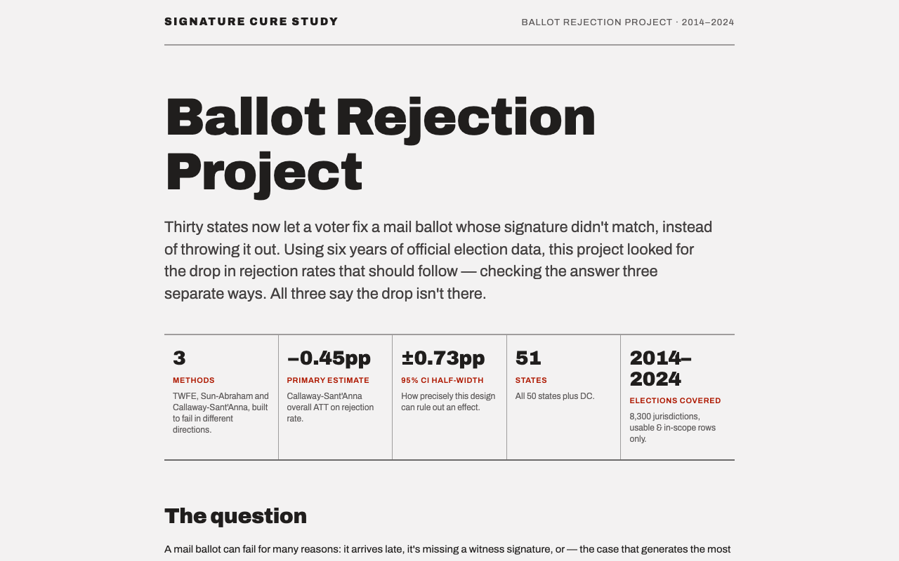
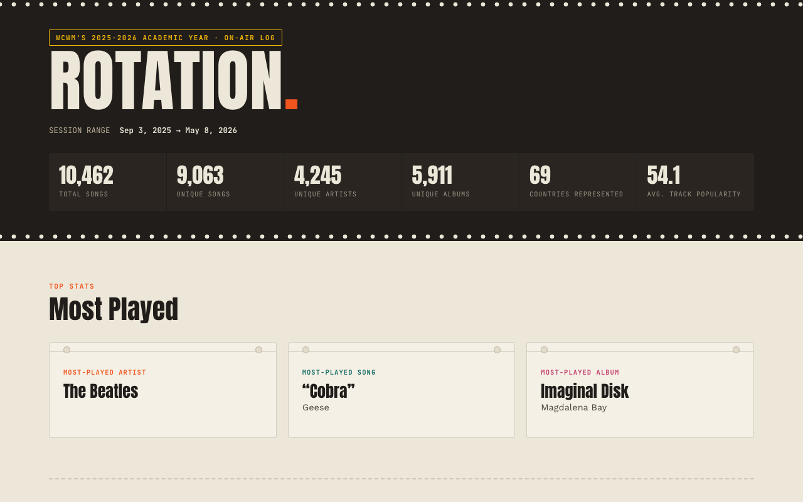

<h1 align="center">Ilias Papageorgiou</h1>

  

  
  

---

### Current Positions

- **International Security Research Associate** — [Futures Group](https://www.wm.edu/offices/global-research/about/research-portfolio/current-cohorts/rmg-american-statecraft/pips/) @ [Robert M. Gates Initiative in American Statecraft](https://www.wm.edu/offices/global-research/about/research-portfolio/current-cohorts/rmg-american-statecraft/)
- **Database Development & Interface Research Assistant** — [US Subnational Democratic Erosion Project](https://democratic-erosion.org/) @ W&M
- **Editor-In-Chief** — [Vinyl Tap Magazine](https://vinyltapmag.com/)
  - Previously Web Editor — built the magazine's website from the ground up

### Most Recently

- **AI Strategy & Insights Intern** — [Medical Knowledge Group](https://www.mkgny.com/#home)
  - Validated the use of LLMs in pharmaceutical market research
  - Direct Report to the Chief AI Officer
  - Worked closely with Data Analytics network-company, [81qd](https://www.81qd.com/)

---

### Featured Projects

#### [Ballot Rejection Project](https://github.com/i-papageorgiou/ballot_rejection_project)

Do state mail-voting rules (signature cure, witness/notary requirements, drop boxes, no-excuse absentee) change how many mail ballots get rejected, and does the effect differ between urban and rural counties? Built a county-level panel from the U.S. Election Assistance Commission's EAVS survey and estimated effects three ways (TWFE, Sun-Abraham, and Callaway-Sant'Anna difference-in-differences). All three point to a null effect. **[Live dashboard →](https://i-papageorgiou.github.io/ballot_rejection_project/)**

`Python` `R` `fixest` `did` `pandas`

#### [Radio Logs Analyzer](https://github.com/WCWM-radio/radio_log_analyzer)

Built for WCWM college radio: turns raw DJ song logs into an enriched spreadsheet with album, release year, and Spotify popularity, normalized Discogs genres and subgenres, and optional artist country of origin (MusicBrainz), plus an auto-generated HTML summary report. Concurrent API lookups cut run time by about 45%. Used to produce *Rotation*, a year-in-review of WCWM's 2025–26 on-air log (10,462 songs from 4,245 artists). **[See the report →](https://wcwm-radio.github.io/radio_log_analyzer/)**

`Python` `Spotify API` `Discogs API` `MusicBrainz`

---

### Tech Stack

  

  
  

---
